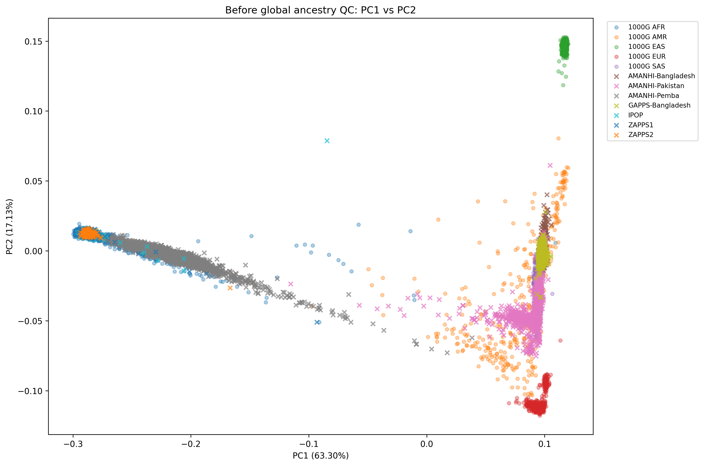
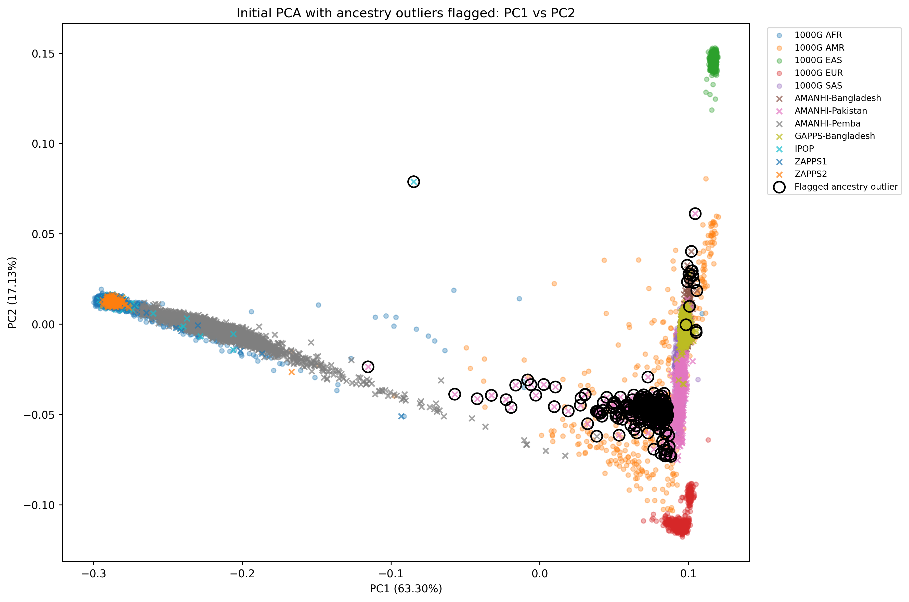
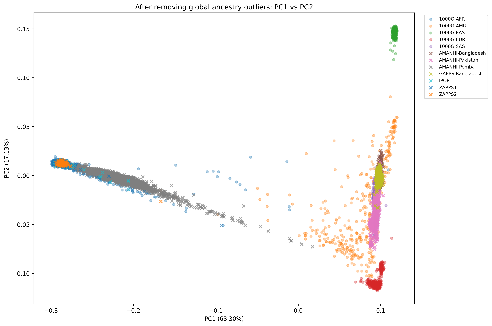

# Maternal PTB Cohort Preparation and Ancestry QC Pipeline

This workflow prepares the maternal pregnancy cohort for downstream mtDNA haplogroup / preterm birth analyses and performs nuclear ancestry QC using projection onto 1000 Genomes Project reference PCA axes.

The pipeline is divided into three major components:

1. Maternal cohort construction and genotype sample selection
2. Study + 1000 Genomes genotype QC and reference projection
3. Global ancestry QC, reference annotation, and final metadata generation

---

## PLINK2 Setup

Install the current PLINK2 release:

```bash
mkdir -p ~/bin/plink2_latest
cd ~/bin/plink2_latest

wget -O plink2.zip \
  https://s3.amazonaws.com/plink2-assets/alpha7/plink2_linux_avx2_20261001.zip

unzip plink2.zip
chmod +x plink2

./plink2 --version

export PATH="$HOME/bin/plink2_latest:$PATH"

which plink2
plink2 --version
```

## RAW COHORT MISSINGNESS

```bash
mkdir -p qc

/home/haltomj/bin/plink2_latest/plink2 \
  --bfile plink2 \
  --missing sample-only \
  --out qc/cohort_raw_missing
```

---

## 1. Maternal Cohort Construction

### Script purpose

`MetadataPrep.py` reconciles pregnancy metadata, sequencing/sample metadata, mtDNA copy-number metadata, raw nuclear-genotype missingness, and Haplogrep3 results to produce one high-quality maternal genotype record per retained pregnancy.

The primary outputs are:

- `momi_mothers_merged.csv`
- `qc/maternal_ptb.keep`

`momi_mothers_merged.csv` contains the final maternal pregnancy metadata used by the downstream ancestry and association-analysis pipelines.

`qc/maternal_ptb.keep` contains the selected maternal PLINK sample IDs used to construct the maternal nuclear-genotype cohort.

---

### Input files

The script uses the following files:

| File | Purpose |
|---|---|
| `momi_pregnancy_level.csv` | Pregnancy-level MOMI clinical and outcome metadata |
| `momi_pregnancy_level_dictionary.csv` | Maps MOMI variable names to standardized/original variable names |
| `samples.tab` | Sample metadata including genotype ID, site, pregnancy ID, mother/child status, Subject_ID, sex, and vial |
| `momi_mtcn_per_sample.csv` | mtDNA copy-number/sample metadata including Gencove genotype IDs and biospecimen information |
| `qc/cohort_raw_missing.smiss` | Raw nuclear-genotype sample missingness generated by PLINK |
| `haplogrep3OUT_22175` | Haplogrep3 maternal mtDNA haplogroup calls and quality scores |

---

### Metadata standardization

MOMI variables are renamed using `momi_pregnancy_level_dictionary.csv`.

Sample identifiers and key metadata fields are cleaned and standardized. Blank strings and values such as `NA`, `N/A`, `nan`, `None`, and `.` are treated as missing.

`SPOTBio` samples are removed from `samples.tab`.

`THSTI` pregnancies are removed from the MOMI pregnancy metadata.

---

### Singleton pregnancy restriction

The maternal analysis is restricted to singleton pregnancies.

After MOMI variable renaming, `SINGLE_TWIN` is converted to numeric and only records with:

`SINGLE_TWIN == 1`

are retained.

Pregnancies coded as non-singleton or with missing `SINGLE_TWIN` are excluded.

Current dataset:

- Original MOMI pregnancies: 22,147
- Singleton pregnancies retained: 21,725
- Non-singleton or missing `SINGLE_TWIN` records removed: 422

---

### Sample reconciliation and genotype availability

Genotype IDs from `momi_mtcn_per_sample.csv` are evaluated against:

1. `samples.tab`
2. the raw nuclear-genotype cohort

A genotype record is considered usable only if its Gencove genotype ID is present in both sources.

Raw genotype sample missingness (`F_MISS`) is obtained from:

`qc/cohort_raw_missing.smiss`

and is used to choose among replicate genotype records.

---

### Replicate and biospecimen resolution

Multiple genotype records can exist for the same biological pregnancy/person because of technical replicates or multiple biospecimen types.

Samples are grouped using the biological key:

`SITE_CODE + ORIG_ID + MC`

where:

- `SITE_CODE` identifies the study site
- `ORIG_ID` identifies the pregnancy
- `MC` distinguishes maternal (`M`) and child (`C`) samples

This key preserves separate pregnancies from the same individual while preventing duplicate representation of the same maternal or child role within a pregnancy.

Among usable genotype records belonging to the same biological key, the genotype with the lowest PLINK `F_MISS` is selected.

Lower `F_MISS` indicates fewer missing nuclear-genotype calls and therefore greater genotype completeness.

If two records have the same `F_MISS`, `gencove_id` is used as a deterministic tie-breaker.

Alternate genotype IDs and biospecimen information are retained for QC and traceability.

The following provenance fields are retained:

- `All_ids`
- `Other_ids`
- `All_biospecimens`
- `All_id_biospecimen_pairs`
- `N_records`
- `N_biospecimens`
- `Multiple_biospecimens`
- `Technical_or_duplicate_records`

In the current dataset, multiple biospecimen types occurred only among child samples; no maternal biological key contained more than one biospecimen type.

---

### Mother-child pairing

After representative genotype records are selected, maternal and child records are separated.

Selected child records are paired to the corresponding maternal pregnancy using:

`merge_site + merge_ORIG_ID`

Pregnancies without an available child genotype are retained in the maternal cohort.

Child genotype provenance is retained in fields including:

- `Child_id`
- `Child_Other_ids`
- `Child_biospecimen`
- `Child_F_MISS`
- `Child_All_biospecimens`
- `Child_All_id_biospecimen_pairs`
- `Child_N_records`
- `Child_N_biospecimens`
- `Child_Multiple_biospecimens`
- `Child_Technical_or_duplicate_records`

This allows the selected child genotype and all alternate genotype/biospecimen combinations to be traced.

---

### Zambia subcohort assignment

Samples originally labeled as `GAPPS-Zambia` are divided into three study subcohorts using the pregnancy/sample identifier:

- IDs beginning with `17` → `IPOP`
- IDs beginning with `30` → `ZAPPS1`
- IDs beginning with `Z2` → `ZAPPS2`

The same subcohort assignment is applied to both sample metadata and MOMI pregnancy metadata before merging.

---

### Pregnancy-mother merge

Maternal genotype records are merged with MOMI pregnancy metadata using:

`merge_site + merge_ORIG_ID`

Both MOMI and maternal genotype records are required to be unique by this key before merging.

The merge is validated as one-to-one.

Pregnancy records without a matched maternal genotype and maternal genotype records without a matched MOMI pregnancy are written to separate QC files.

---

### Final maternal cohort filters

After MOMI and maternal genotype records are matched, the cohort is restricted to:

1. singleton pregnancies (`SINGLE_TWIN == 1`)
2. live births (`PREG_OUTCOME == 2`)
3. maternal samples with a Haplogrep3 result
4. Haplogrep3 quality score `>= 0.90`

The current pre-1000 Genomes maternal cohort contains:

| Site | N |
|---|---:|
| AMANHI-Bangladesh | 1,213 |
| AMANHI-Pakistan | 1,400 |
| AMANHI-Pemba | 3,138 |
| GAPPS-Bangladesh | 2,559 |
| IPOP | 625 |
| ZAPPS1 | 415 |
| ZAPPS2 | 180 |
| **Total** | **9,530** |

Each retained pregnancy corresponds to exactly one unique maternal genotype ID.

The final PLINK keep file therefore contains 9,530 unique maternal genotype IDs.

---

### Main outputs

| Output | Description |
|---|---|
| `momi_mothers_merged.csv` | Final maternal pregnancy/genotype metadata after singleton, live-birth, and Haplogrep3 QC filters |
| `qc/maternal_ptb.keep` | PLINK keep file containing the final maternal genotype IDs |
| `mtcn_selected_samples.tsv` | One selected genotype record per biological pregnancy-role key |
| `selected_mothers.csv` | Selected maternal genotype metadata before MOMI filtering |
| `selected_children.csv` | Selected child genotype metadata before MOMI filtering |
| `multiple_biospecimen_groups.tsv` | Records belonging to biological keys with more than one biospecimen type |
| `duplicate_sitecode_ORIGID_MC.tsv` | Duplicate biological-key QC table |
| `groups_without_usable_genotype.tsv` | Biological keys for which no usable genotype could be selected |
| `momi_unmatched.csv` | MOMI pregnancies without a matched maternal genotype |
| `mothers_unmatched.csv` | Maternal genotype records without a matched MOMI pregnancy |

---

### Run

```bash
python MetadataPrep.py
```

## CREATE INITIAL MATERNAL PLINK COHORT

The maternal PLINK keep file (`maternal_ptb.keep`) generated during metadata preparation is used to subset the full nuclear-genotype dataset to the selected maternal analysis cohort.

```bash
/home/haltomj/bin/plink2_latest/plink2 \
  --bfile plink2 \
  --keep metadata/qc/maternal_ptb.keep \
  --make-bed \
  --out qc/maternal_ptb

# These should match.
wc -l metadata/qc/maternal_ptb.keep
wc -l qc/maternal_ptb.fam
```

---

## 2. Study + 1000 Genomes Genotype QC and Reference Projection

### Purpose

The Snakefile performs joint autosomal nuclear-genotype quality control using the maternal study cohort together with 1000 Genomes Project (1000G) reference samples.

After joint genotype QC and LD pruning, principal components are calculated using only the 1000G reference samples. The maternal study samples are then projected onto these fixed 1000G-defined PCA axes.

The 1000G reference PCA and study projection are generated once.

The same fixed 1000G-defined PCA space is then used for both ancestry QC and final ancestry annotation.

### Reference PCA and projection

The workflow starts from the full maternal genotype cohort:

`qc/maternal_ptb`

It performs joint study + 1000G genotype QC, calculates the PCA axes from the 1000G reference samples only, and projects both the study samples and 1000G samples onto those fixed reference axes.

These projected coordinates are used for broad ancestry QC and downstream ancestry annotation.

Primary projection outputs:

- `pca/1000G_projection.eigenvec`
- `pca/1000G_projection.eigenval`

Because the study samples do not define the PCA axes, removing ancestry outliers does not require a second PCA or projection run.

---

### Reference PCA and projection workflow

The Snakefile performs the following steps:

1. Download 1000 Genomes GRCh38 reference VCFs for autosomes 1–22.
2. Convert each 1000G chromosome to PLINK2 format.
3. Restrict the 1000G reference to biallelic A/C/G/T SNPs and standardize 1000G variant IDs as `CHR:POS:REF:ALT`.
4. Identify autosomal biallelic A/C/G/T SNP IDs shared between the maternal study cohort and 1000G.
5. Extract the shared SNPs independently from the study and 1000G datasets.
6. Merge the study cohort and 1000G reference chromosome-by-chromosome.
7. Convert the chromosome-level merged datasets to PLINK2 PGEN format.
8. Merge chromosomes 1–22 into a single joint study + 1000G genotype dataset.
9. Calculate joint sample and variant genotype missingness before QC.
10. Apply variant-level QC:
    - `--geno 0.02`: remove variants with >2% missing genotype calls
    - `--maf 0.05`: retain variants with minor allele frequency >=5%
11. Recalculate sample missingness after variant-level filtering.
12. Apply sample-level QC:
    - `--mind 0.05`: remove samples with >5% missing genotype calls
13. Calculate post-QC sample missingness for QC documentation.
14. Exclude the GRCh38 chromosome 6 region 25–35 Mb from the set of variants considered for LD pruning. This region is excluded from PCA marker selection because of extended linkage disequilibrium; it is not removed from the underlying QC genotype dataset.
15. Perform genome-wide LD pruning using `--indep-pairwise 200 50 0.2`, corresponding to:
    - 200-variant window
    - 50-variant step
    - LD threshold of r² = 0.2
16. Using the LD-pruned SNP set, calculate 20 principal components from the 1000G reference samples only.
17. Save the 1000G PCA allele weights and 1000G allele frequencies required for projection.
18. Project both the maternal study samples and the 1000G reference samples onto the fixed 1000G PCA axes using the saved allele weights and reference allele frequencies.
19. Write the projected PCA coordinates to:
    - `pca/1000G_projection.eigenvec`
    - `pca/1000G_projection.eigenval`

The PCA axes are defined by the 1000G reference panel, and the study samples are projected onto those fixed reference axes.

---

### Run reference PCA and projection

```bash
snakemake \
  -j 22 \
  -s snakefile \
  --use-conda \
  --latency-wait 60 \
  --cluster "sbatch -t 05:00:00 -c 8 -N 1"
```

---

## 3. Global ancestry QC, reference annotation, and final metadata generation

### Purpose

`globalPCA_pipeline.py` uses the fixed 1000G-reference projection generated by the Snakefile to perform both broad ancestry QC and final ancestry annotation in a single run.

The PCA itself is not recalculated. The same fixed 1000G-defined PCA coordinate system is used throughout the analysis.

The script:

- reads the fixed 1000G-projected PCA coordinates
- attaches study-site and 1000 Genomes ancestry labels
- assigns each study sample an expected broad ancestry group
- builds broad AFR and SAS reference models from 1000 Genomes samples
- calculates multivariate ancestry distance using PC1-PC5
- defines conservative ancestry-outlier thresholds
- flags samples that fall outside the expected ancestry distribution
- generates diagnostic PCA plots and QC tables
- removes flagged study samples from the retained cohort
- validates the retained sample IDs against the maternal PLINK `.fam`
- writes the ancestry-clean PLINK keep file
- immediately continues using the retained study samples in the same fixed PCA space
- compares retained study samples with individual 1000 Genomes reference populations
- identifies the nearest 1000 Genomes population reference
- calculates ancestry-distance metrics
- evaluates broad superpopulation concordance
- attaches `Global_PC1`–`Global_PC20` to the maternal metadata
- merges maternal weight
- generates the final analysis-ready metadata file

The broad ancestry-QC threshold is defined from leave-one-out 1000G reference distances using:

`OUTLIER_QUANTILE = 0.999`

and ancestry distance is calculated using:

`PC1`–`PC5`

Main outputs:

```text
qc/maternal_ptb_globalPCA.keep
pca/global_qc/final_1KGP_nearest_reference.csv
metadata/momi_mothers_ultimate.csv
```

### Run

```bash
python globalPCA_pipeline.py
```

---

### Broad ancestry QC visualization

Initial projected PCA:



Samples flagged by the ancestry-QC criterion are outlined in black:



PCA visualization after removing flagged ancestry outliers:



---

### Optional: create ancestry-clean maternal PLINK cohort

The ancestry-clean PLINK dataset may be created for downstream genotype analyses. It is not required for the PCA or final ancestry annotation because `globalPCA_pipeline.py` directly retains the ancestry-clean study samples in the original fixed 1000G projection.

```bash
/home/haltomj/bin/plink2_latest/plink2 \
  --bfile qc/maternal_ptb \
  --keep qc/maternal_ptb_globalPCA.keep \
  --make-bed \
  --out qc/maternal_ptb_globalPCA

wc -l qc/maternal_ptb_globalPCA.fam
```

---

### Final ancestry annotation

After ancestry outliers are removed in memory, the script continues directly to final ancestry annotation without recalculating the PCA.

The retained study samples are compared with individual 1000 Genomes reference populations in the same fixed PCA coordinate system.

For each retained maternal sample, the script records:

- nearest 1000G population reference
- nearest 1000G superpopulation
- second-nearest 1000G population reference
- Mahalanobis distance metrics
- empirical reference percentile
- distance-to-threshold ratio
- expected-superpopulation concordance
- nearest reference restricted to the expected AFR or SAS superpopulation
- projected global PC coordinates

Nearest 1000G population labels are descriptive measures of genetic reference similarity and should not be interpreted as literal ethnicity or population identity.

The final maternal metadata file is:

```text
metadata/momi_mothers_ultimate.csv
```

This file contains the retained ancestry-QC maternal cohort together with the projected global PCs and 1000G reference annotations for downstream association analyses.

---

## Complete workflow

```bash
python MetadataPrep.py

/home/haltomj/bin/plink2_latest/plink2 \
  --bfile plink2 \
  --keep metadata/qc/maternal_ptb.keep \
  --make-bed \
  --out qc/maternal_ptb

snakemake \
  -j 22 \
  -s snakefile \
  --use-conda \
  --latency-wait 60 \
  --cluster "sbatch -t 05:00:00 -c 8 -N 1"

python globalPCA_pipeline.py
```
