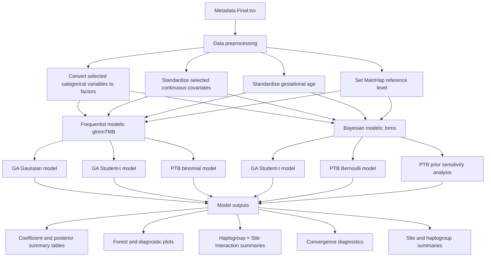
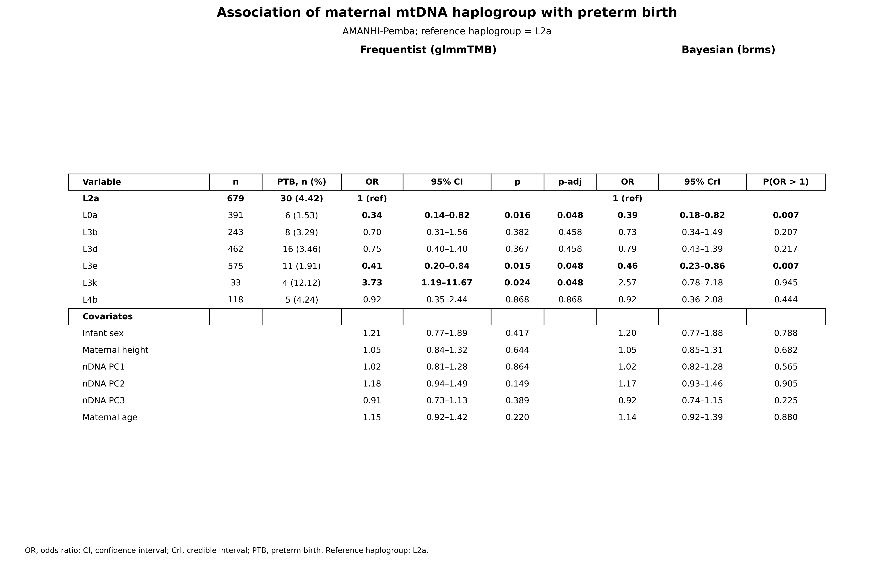
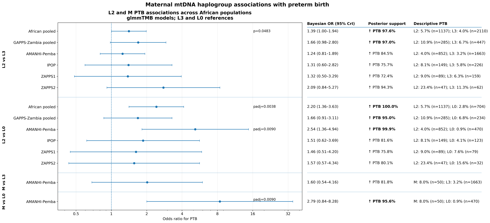

# mtDNA Pre-Term Birth Association Pipeline

## Overview (finalModel_freq_vs_bayesian.r)
This pipeline evaluates associations between **mitochondrial DNA (mtDNA) haplogroups** and:

- **Gestational Age (GA)** — continuous outcome
- **Pre-Term Birth (PTB)** — binary outcome

using both **Frequentist** (`glmmTMB`) and **Bayesian** (`brms`) frameworks. The pipeline supports pooled multi-site analyses and can also be applied to single-site datasets when site-filtered input is provided. The pipeline supports:

- Dynamic covariate selection at runtime
- Fixed (`site`) or random (`(1 | site)`) site effects
- Frequentist Gaussian and Student-t GA models
- Bayesian posterior probability estimation
- Prior sensitivity analyses for PTB
- Benjamini–Hochberg multiple-testing correction for haplogroup effects and site-specific pairwise haplogroup contrasts
- Sparse-cell detection
- Automated convergence diagnostics
- Multi-site haplogroup × site interaction analyses to assess effect heterogeneity across study sites

The same script supports pooled multi-site analyses, fixed-site analyses, random-site analyses, and single-site analyses by specifying the desired model formula at runtime. For datasets containing more than one study site, the pipeline also performs a secondary haplogroup × site interaction analysis to evaluate whether haplogroup associations differ across sites.

---

## Analysis Workflow



## Statistical Framework

### Frequentist Models (`glmmTMB`)

#### Gestational Age (GA)
Two models are fit:

1. **Gaussian**
2. **Student-t**

Model fit comparison:

- `AIC`

Formula:

```r
GAGEBRTH_NEW ~ MainHap + covariates
```

#### Pre-Term Birth (PTB)

Logistic regression (family = binomial):

```r
PTB ~ MainHap + covariates
```

Outputs:

- Odds ratios (OR)
- Confidence intervals
- Forest plots
- Estimated marginal means (predicted PTB probabilities)
- Pairwise comparisons

---

#### Multi-site Haplogroup × Site Interaction Analysis

For datasets containing more than one study site, an additional interaction analysis is performed to assess whether the association between mtDNA haplogroup and PTB differs across study sites.

This analysis is treated as a **heterogeneity / sensitivity analysis**. The primary pooled analysis remains the additive haplogroup model.

Two nested frequentist binomial models are fit (binomial):

**Additive model**

```r
PTB ~ MainHap + site + covariates
```
**Interaction model** 

```r
PTB ~ MainHap * site + covariates
```
(MainHap * site) expands to:  MainHap + site + MainHap:site
The interaction model includes both the main site effect and site-specific modification of the haplogroup effect.

**Global test of effect heterogeneity**
The additive and interaction models are compared using a likelihood-ratio test. The null hypothesis is that haplogroup effects are the same across sites.

The omnibus interaction test is the primary test of site heterogeneity. Individual interaction coefficients are considered secondary and should not be interpreted in isolation when the omnibus interaction test is non-significant.
Adjusted haplogroup estimates are obtained within each site and pairwise haplogroup comparisons are then calculated separately within each site. These estimates are useful for describing the direction and magnitude of haplogroup effects within each population, even when the global interaction test does not support statistically significant effect modification.
**Model fit comparison**
AIC, BIC, and log-likelihood are reported for both the additive and interaction models. Lower AIC/BIC values favor the simpler additive model unless the interaction meaningfully improves model fit.
**Interaction-model diagnostics**
DHARMa simulated residual diagnostics are generated for the interaction model to evaluate model adequacy.


### Bayesian Models (`brms`)

#### Gestational Age

Family:

```r
student()
```

Posterior probabilities:

- Pr(β > 0)
- Pr(β < 0)
- Pr(effect > +1 day)
- Pr(effect < −1 day)

Posterior probabilities are reported for all fixed effects
(haplogroups, covariates, principal components, and site fixed effects
when included).

Effects are back-transformed to **days**.

#### Pre-Term Birth

Family:

```r
bernoulli()
```

Posterior probabilities:

- `Pr(OR > 1)`

Posterior probabilities are reported for all fixed effects
(haplogroups, covariates, principal components, and site fixed effects
when included).

---


## Bayesian Priors and Sampler Settings
#### Gestational Age (GA) Priors

For the final Bayesian GA model,
all fixed-effect coefficients
(haplogroups, covariates, PCs and fixed site effects)
use

```
normal(0, 0.5)
```
Because GAGEBRTH_NEW is standardized prior to model fitting, this prior operates on the standardized gestational-age scale. Posterior estimates are later back-transformed to gestational days for interpretation.

Additional priors:
```
sigma ~ student_t(3, 0, 2.5)
```
When random site effects are included ((1 | site)):
```
site random-effect SD ~ student_t(3, 0, 2.5)
```
#### Pre-Term Birth (PTB) Priors

For the final Bayesian PTB model, all fixed effects use:
```
normal(0, 1.0)
```
on the log-odds scale.

When random site effects are included ((1 | site)):
```
site random-effect SD ~ student_t(3, 0, 2.5)
```

#### PTB prior sensitivity analyses evaluate:
PTB Bayesian models are re-fit under multiple prior specifications to evaluate robustness of haplogroup effects to prior choice.

| Prior | Meaning |
|---|---|
| `Normal(0,0.5)` | Strong shrinkage |
| `Normal(0,1.0)` | Moderate shrinkage |
| `Normal(0,2.5)` | Weak shrinkage / diffuse prior |
| `brms_default` | Default weakly informative priors |

### Sampler Settings

To improve MCMC convergence and reduce divergent transitions, customized sampler controls are used.

GA model:
```
adapt_delta = 0.999
max_treedepth = 15
chains = 4
iter = 4000
```
PTB model:
```
adapt_delta = 0.995
max_treedepth = 13
chains = 4
iter = 3000
warmup = 1000
```
### Posterior summaries include:

Bayesian models do not report p-values or adjusted p-values.
Instead, inference is based on posterior probabilities
(e.g. Pr(OR > 1), Pr(β > 0), and posterior credible intervals),
which directly quantify evidence for an effect.

- Posterior mean estimates
- 95% credible intervals
- Posterior probability metrics
  
## Input File

Required input:

```text
Metadata.Final.tsv
```

### Required Variables

#### Outcomes
- `GAGEBRTH_NEW`
- `PTB`

#### mtDNA
- `MainHap`

#### Site
- `site`

#### Categorical Covariates
- `FUEL_FOR_COOK`
- - `BABY_SEX`
- `CHRON_HTN`
- `DIABETES`
- `HH_ELECTRICITY`
- `TB`
- `THYROID`
- `TYP_HOUSE`
- `biospecimen`
#### Continuous / Ordinal Covariates
- `PW_AGE`
- `PW_EDUCATION`
- `MAT_HEIGHT`
- `MAT_WEIGHT`
- `BMI`
- `TOILET`
- `WEALTH_INDEX`
- `DRINKING_SOURCE`
- `PC1–PC5`
- `mtcn`


---

## Data preprocessing
- Categorical variables converted to factors (as.factor)
- Continuous and ordinal variables standardized (scale()) (mean 0, SD 1)
- Gestational age (GAGEBRTH_NEW) standardized for model fitting and back-transformed to days for interpretation

## Running the Pipeline

### Syntax

```bash
Rscript finalModel.R REF "COVARIATES"
```

### Examples

Fixed site:

```bash
Rscript finalModel.R M "PW_AGE + MAT_HEIGHT + site"
```

Random site:

```bash
Rscript finalModel.R M "PW_AGE + BMI + (1 | site)"
```

With PCs:

```bash
Rscript finalModel.R M "PW_AGE + BMI + PC1 + PC2 + PC3 + (1 | site)"
```

---

## Output Directory Naming

Example:

```text
model_outputs/
└── M_PW_AGE_BMI_siteRE/
```

Encodes:

- Reference haplogroup
- Covariates
- Fixed vs random site effect

---

## Output Files

### Frequentist Results

| File | Description |
|---|---|
| `ga_glmmtmb_gaussian.csv` | Gaussian GA model coefficients with AIC/BIC |
| `ga_glmmtmb_student_t.csv` | Student-t GA coefficients with AIC/BIC |
| `ga_glmmtmb_gaussian_vs_student_t_AIC.csv` | AIC comparison |
| `ptb_glmmtmb.csv` | PTB logistic model with AIC/BIC |
| `ptb_glmmtmb_site_forest.png` | PTB odds-ratio forest plot |
| `ptb_glmmtmb_emmeans_probs.csv` | Predicted PTB probabilities |
| `ptb_glmmtmb_emmeans_pairs_BH.csv` | Pairwise BH-adjusted comparisons |
| `ptb_MainHap_site_interaction_LRT.csv` | Likelihood-ratio test comparing additive and MainHap × site interaction models |
| `ptb_MainHap_site_interaction_coefficients.csv` | Fixed-effect coefficients from the MainHap × site interaction model, including ORs and confidence intervals |
| `ptb_MainHap_site_emmeans_probs.csv` | Adjusted haplogroup-specific PTB probabilities within each study site |
| `ptb_MainHap_site_emmeans_pairs_BH.csv` | Site-specific pairwise haplogroup comparisons with BH adjustment |
| `ptb_MainHap_site_model_comparison.csv` | AIC, BIC, and log-likelihood comparison of additive and interaction models |
| `ptb_MainHap_site_interaction_DHARMa.png` | DHARMa residual diagnostics for the MainHap × site interaction model |

### Bayesian Results

| File | Description |
|---|---|
| `ga_brm.csv` | Bayesian GA fixed effects |
| `ga_brm_summary.txt` | Full GA model summary |
| `ga_brm_bayesR2.txt` | Bayesian R² |
| `ga_brm_posterior_probs.csv` | Posterior summaries for all fixed effects, including posterior probabilities and back-transformed gestational-age effects. |
| `ptb_brm_summary.txt` | PTB Bayesian model summary |
| `ptb_brm_final_fixed_effects.csv` | Posterior summaries for all fixed effects,including odds ratios, credible intervals, posterior probabilities, Rhat and ESS. |
| `ptb_brm_prior_sensitivity_haps.csv` | Prior sensitivity results |

### Diagnostics

| File | Description |
|---|---|
| `*_traceplot.png` | Chain mixing plots |
| `*_pp_check.png` | Posterior predictive checks |
| `*_diagnostics.txt` | Divergences, treedepth hits, BFMI |
| `*_draws_summary.csv` | Posterior draw statistics |
| `*_fixed_effects_summary.csv` | Fixed effect summary |
| `*_nuts_params.csv` | Raw NUTS diagnostics |
| `*_bad_rhat.csv` | Parameters with Rhat > 1.01 |
| `*_low_ess_bulk.csv` | Low bulk ESS |
| `*_low_ess_tail.csv` | Low tail ESS |
| `*_glmmtmb_DHARMa.png` | residual diagnostics |


Each Bayesian model automatically exports:

* Trace plots for visual assessment of chain mixing
* Posterior predictive checks
* Rhat summaries
* Bulk effective sample size
* Tail effective sample size
* Divergence counts
* Maximum treedepth diagnostics
* BFMI or sampler-energy diagnostics
* Raw NUTS sampler parameters

These outputs are generated by the automated Bayesian diagnostics function for the final GA and PTB models.


### Cohort Summary Outputs

| File | Description |
|---|---|
| `site_summary.csv` | Site-level descriptive statistics |
| `hap_ptb_counts.csv` | PTB counts by haplogroup |
| `hap_site_ptb_table.csv` | Haplogroup × site PTB table |
| `hap_site_ptb_rate_barplot.png` | Haplogroup × site PTB barplot |
| `hap_site_ptb_flags.csv` | Sparse/problematic cell flags (eg. sparse_cell = n_total < 5,low_events  = n_ptb < 2) |
| `hap_site_ptb_problem_cells.csv` | Problematic cells only |
| `model_formula_used.txt` | Exact formulas and parameters |
| `site_categorical_summary.csv` | Site-level categorical covariate distributions |

### RDS Outputs

| File | Description |
|---|---|
| `ga_brm.rds` | Serialized GA brms model |
| `ptb_brm_final.rds` | Serialized final PTB model |
| `ptb_brm_sensitivity_*.rds` | Serialized PTB sensitivity models |

---

## Interpretation

### GA

`Pr(effect > +1 day)`

Probability a haplogroup increases gestational age by >1 day.

Example:

`0.97`

→ 97% posterior probability of >1 gestational day increase.

### PTB

`Pr(OR > 1)`

Probability a haplogroup increases PTB odds.

Example:

`0.98`

→ 98% posterior probability of elevated PTB odds.

### Multiple Testing

Benjamini–Hochberg multiple-testing correction is applied to haplogroup-specific frequentist comparisons.
For the primary glmmTMB analyses, BH adjustment is applied to MainHap effects.
For the multi-site interaction analysis, BH adjustment is also applied to site-specific pairwise haplogroup contrasts generated using `emmeans`.
The omnibus Haplogroup × site likelihood-ratio test is a single global heterogeneity test and is not BH-adjusted.
Bayesian models use posterior probabilities and do not perform frequentist multiple-testing correction.


### MainHap × Site Interaction

The `Haplogroup × site` analysis evaluates whether the haplogroup–PTB association differs across study sites.

The primary inference is based on the omnibus likelihood-ratio test comparing:

```r
PTB ~ MainHap + site + covariates
```
against:
```r
PTB ~ MainHap * site + covariates
```
A non-significant interaction test indicates that there is insufficient evidence that haplogroup effects differ across sites. In this situation, the additive pooled model remains the preferred primary model.

---

## Convergence Guidelines

Automated convergence diagnostics are saved for all Bayesian models.

Recommended thresholds:

| Metric | Target |
|---|---|
| Divergences | 0 |
| Rhat | < 1.01 |
| ESS | > 400 |
| Treedepth hits (>=max_treedepth) | Minimal |

If convergence is poor increase :

```r
adapt_delta = 0.999
iter = 6000
warmup = 2000
```
and/or use slightly stronger priors. 

---

## DHARMa evaluates:

- Residual uniformity
- Overdispersion
- Outliers
- Zero inflation
- Model misspecification
- Heteroscedasticity

#### Interpretation Guidelines

**Good model fit:**

- Residuals appear randomly distributed
- QQ plot approximately follows expected line
- No strong residual trends

**Potential issues:**

- Systematic residual patterns → model misspecification
- Strong QQ deviations → poor distributional assumptions
- Overdispersion → variance not adequately modeled
- Clustering or structure → missing covariates or interactions

The **Student-t GA model** is often preferred when Gaussian residual assumptions are violated due to heavy tails or outliers.

## Reproducibility

Random seed:

```r
set.seed(2025)
seed = 2025
```

---


# Site and nDNA PC associated

This script tests whether nDNA principal components are strongly associated with study site. It performs ANOVA with R² estimation for individual PCs, MANOVA across all PCs, and PERMANOVA to quantify the proportion of overall ancestry structure explained by site. These results help determine whether study site can be used as a proxy for ancestry in downstream association models.

```
python site_pc_structure_tests.py \
  --input Metadata.Final.tsv \
  --sep $'\t' \
  --site-col site \
  --pc-prefix PC \
  --n-pcs 5 \
  --permutations 999 \
  --out-prefix nDNA_PC_site

```
Output Files:

1.  *_anova_r2.csv – Per-PC ANOVA results showing the strength of association between study site and each nDNA principal component, including R² (variance explained by site).
- PC – principal component tested (e.g., PC1–PC5)
- F – ANOVA F-statistic
- p_value – statistical significance of site effect
- R2 – proportion of variance in the PC explained by study site
- adj_R2 – adjusted R² accounting for model complexity

2. *_manova.txt – MANOVA results testing whether study site explains overall variation across all included principal components simultaneously.
- Wilks’ lambda
- Pillai’s trace
- Hotelling–Lawley trace
- Roy’s greatest root
  
4. *_permanova.csv – PERMANOVA results quantifying the proportion of multivariate ancestry structure explained by study site (R²) and its statistical significance.
- permanova_F – PERMANOVA F-statistic
- permanova_R2 – fraction of total multivariate variance explained by site
- permanova_p – permutation-based significance value
- df_between / df_within – model degrees of freedom
- n_permutations – number of permutations performed
  
5. *_site_pc_summary.csv – Summary statistics (mean, standard deviation, sample count) for each principal component stratified by study site.


# Summary Table Generator: 

ModelSummaryTable.py: A Python script was developed to automatically summarize results from all final association models across populations and reference haplogroups. The script recursively identified each completed model run, extracted Bayesian (brms) and frequentist (glmmTMB) results for gestational age (GA) and preterm birth (PTB), standardized effect estimates and confidence/credible intervals into a common format, and annotated each result with the corresponding population, reference haplogroup, model equation, and covariate set. For PTB analyses, haplogroup-specific sample counts, PTB rates, term birth counts, and descriptive summaries were merged from precomputed haplogroup frequency tables. For GA, haplogroup-specific sample counts are added to the table. Model fit statistics (AIC, BIC, and log-likelihood), when available, were also retained. Individual results were then concatenated into comprehensive summary tables for GA and PTB separately, providing a unified output for downstream interpretation and manuscript preparation.
- Script needs to be placed in the directory before Population/mtDNA-Pre-term-birth-association-/Final_Model_Results
- Update populations variable in this script accordingly.

```
populations = [
    "African",
    "GAPPS-Zambia",
    "IPOP",
    "ZAPPS1",
    "ZAPPS2",
    "AMANHI-Pemba"
]
```

### Statistical Models

| Outcome | Frequentist (glmmTMB) | Bayesian (brms) |
|---|---|---|
| Gestational age (GA) | Gaussian and Student-t | Student-t |
| Preterm birth (PTB) | Binomial (logit) | Bernoulli (logit) |

### Bayesian Priors for ModelSummaryTable.py

| Model | Parameter | Prior |
|---|---|---|
| GA (Student-t) | Fixed effects | Normal(0, 0.5) |
| GA (Student-t) | Residual SD (σ) | Student-t(3, 0, 2.5) |
| PTB (Bernoulli) | Fixed effects | Normal(0, 1.0) |
| GA / PTB | Site random-effect SD, if included | Student-t(3, 0, 2.5) |

All fixed-effect priors apply to haplogroup and included covariates (e.g., PCs, clinical covariates, sex, and fixed site effects).  


- This output will be used to find the best model (Alt vs base) by looking for a >=10% odds-ratio/Effect-size shift (ES_ShiftCheck.py and OR_ShiftCheck.py) from the base for significant haplogroups (padj< 0.05). If such a shift were to occur, it would mean the cov in the alt model is confounding with haplogroup and should be included in the final model.


### Publication-Ready Summary Tables: FinalTable_PubReady.py
This script generates publication-ready summary tables for maternal mtDNA haplogroup associations with preterm birth (PTB) using table from ModelSummaryTable.py. It combines frequentist glmmTMB and Bayesian brms results with haplogroup sample sizes and PTB frequencies, reporting odds ratios, 95% confidence/credible intervals, adjusted p-values, and posterior probabilities. Results are formatted into publication-quality PNG and PDF tables, with the underlying combined results also exported as a CSV.




## Selected PTB Forest Plot Generator: PubReadyPlot.py

A Python plotting script generates publication- and presentation-ready forest plots for selected maternal mtDNA haplogroup associations with preterm birth. Takes in table from ModelSummaryTable.py

The same script supports both:

- `MainHap`
- `SubHap`

using the user setting:

```python
ANALYSIS = "MainHap"
```


